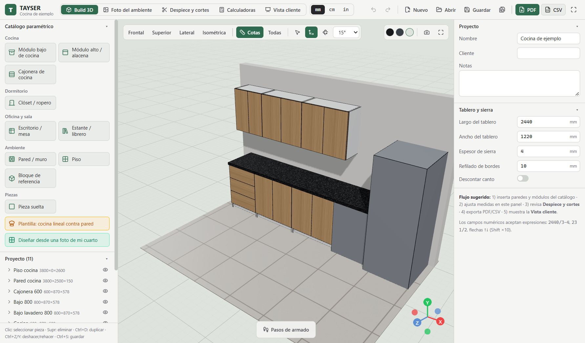
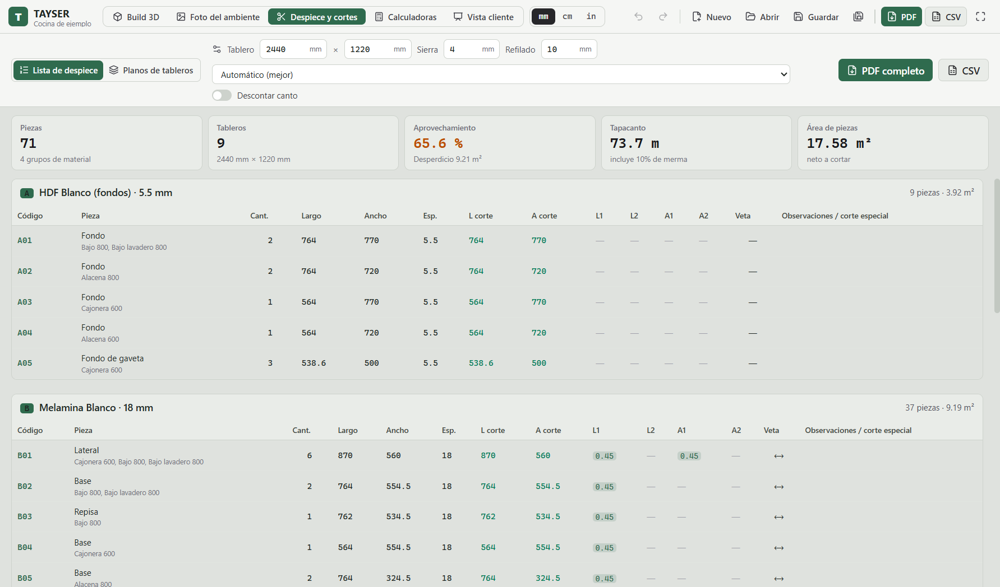
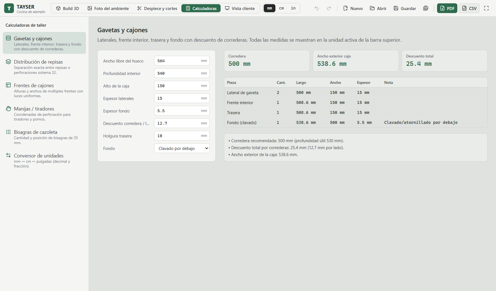
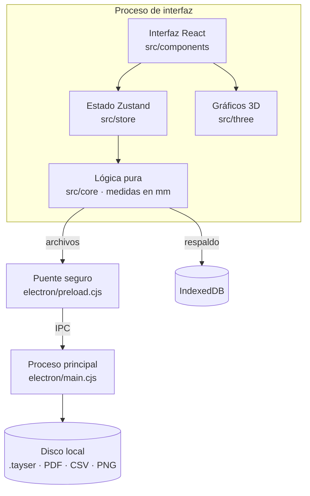

# Tayser

**Diseño paramétrico 3D, despiece y optimización de tableros para carpintería. Funciona 100 % sin Internet.**

Tayser es una aplicación de escritorio para talleres que trabajan con melamina, MDF, madera y pino. Eliges un mueble, escribes sus medidas y el programa dibuja el modelo en 3D, calcula todas las piezas con sus tapacantos y acomoda los cortes en los tableros para desperdiciar lo menos posible. Al final exportas el despiece y los planos de corte en PDF o CSV.

No usa servidores, APIs ni cuentas: el programa bloquea toda conexión externa y las texturas de madera, ladrillo o granito se generan por código.

> **¿Solo quieres instalarlo?** Sigue la [guía de instalación](INSTALACION.md).



---

## Contenido

1. [Qué puedes hacer](#qué-puedes-hacer)
2. [Instalación rápida](#instalación-rápida)
3. [Cómo se usa](#cómo-se-usa)
4. [Los cinco modos](#los-cinco-modos)
5. [Catálogo de muebles](#catálogo-de-muebles)
6. [Materiales y tapacantos](#materiales-y-tapacantos)
7. [Atajos de teclado](#atajos-de-teclado)
8. [Archivos y respaldo](#archivos-y-respaldo)
9. [Arquitectura](#arquitectura)
10. [Estructura del proyecto](#estructura-del-proyecto)
11. [Comandos](#comandos)
12. [Tecnologías](#tecnologías)
13. [Limitaciones y próximos pasos](#limitaciones-y-próximos-pasos)
14. [Documentos del proyecto](#documentos-del-proyecto)

---

## Qué puedes hacer

- Diseñar cocinas, clósets, escritorios, estantes y muebles a medida en 3D.
- Cambiar una medida y ver al instante el modelo, el despiece y los cortes actualizados.
- Obtener la lista de piezas con medidas de corte, cantidades, veta y tapacantos por lado.
- Calcular los metros de tapacanto por grosor, con merma incluida.
- Acomodar las piezas en tableros respetando la sierra, el refilado y la veta.
- Hacer cortes especiales: esquinas redondeadas, diagonales, biseles, calados, espigas y piezas torneadas.
- Calcular gavetas, repisas, frentes, manijas y bisagras.
- Mostrar el diseño al cliente con acabados intercambiables.
- Planificar un cuarto a partir de una foto: Tayser propone dónde va cada mueble.
- Exportar a PDF, CSV y PNG.

---

## Instalación rápida

Necesitas **Windows 10/11 de 64 bits** y **Node.js 20.19 o superior** (recomendado 22 LTS).

```bash
git clone https://github.com/Lincol15/escritorio_tayser.git
cd escritorio_tayser
npm install
npm run dev
```

La guía completa, con la instalación de Node.js, cómo generar el instalador `.exe` y solución de problemas, está en **[INSTALACION.md](INSTALACION.md)**.

---

## Cómo se usa

1. Pulsa **Nuevo** para empezar vacío, o usa la plantilla **Cocina lineal contra pared**.
2. Elige la unidad de trabajo en la barra superior: `mm`, `cm` o `in`.
3. En **Build 3D**, agrega muebles desde el **Catálogo paramétrico** (panel izquierdo).
4. Selecciona un mueble y ajusta sus medidas y materiales en el panel derecho.
5. Haz clic en una pieza para editar sus tapacantos, su veta o sus cortes especiales.
6. Ubica los muebles: mover (`G`), rotar (`R`), alinear a la pared o pegar a otro módulo.
7. Ve a **Despiece y cortes**, configura el tablero (largo, ancho, sierra, refilado) y revisa el aprovechamiento.
8. Exporta con **PDF completo** o **CSV**.
9. Presenta el diseño en **Vista cliente**.
10. Guarda con `Ctrl+S` (archivo `.tayser`).

Los campos numéricos aceptan operaciones: `2440/3-4`, `23 1/2`, y las flechas ↑↓ suben o bajan el valor (Shift multiplica por 10).

---

## Los cinco modos

### Build 3D

El espacio de diseño. Aquí armas la escena con muebles, paredes y pisos.

- Varios muebles a la vez, con mover y rotar usando imán de 5, 15, 45 o 90°.
- Alinear contra la pared y pegar un módulo a la izquierda o derecha de otro.
- Ocultar módulos o piezas sueltas para ver el interior.
- Cotas 3D del mueble seleccionado o de todos.
- Vistas Frontal, Superior, Lateral e Isométrica (teclas `1` a `4`).
- Pasos de armado animados, pieza por pieza.
- Fondo oscuro, gris o claro; captura PNG y pantalla completa.

**Cortes especiales por pieza:** radios por esquina, cortes diagonales, biseles con ángulo, calados rectangulares o circulares, espigas, y piezas cilíndricas o cónicas. Se ven en 3D y aparecen en las observaciones del despiece.

### Despiece y cortes



- Piezas agrupadas por material y espesor, con código (A01, B01…), cantidad, medidas nominales y de corte.
- Tapacantos por lado: **L1, L2** (a lo largo) y **A1, A2** (a lo ancho).
- Opción para descontar el grosor del canto de la medida de corte.
- Resumen: piezas, tableros, aprovechamiento, metros de tapacanto y área total.
- **Planos de tableros:** cada tablero dibujado con sus piezas y su porcentaje de aprovechamiento.
- Algoritmos de optimización: **MaxRects**, **Guillotina** (cortes de borde a borde, como en sierra escuadradora) o **Automático**, que elige el mejor.
- Exporta un **PDF completo** (resumen, despiece y planos de corte) o un **CSV** para Excel.

### Calculadoras



| Calculadora | Qué calcula |
| --- | --- |
| Gavetas y cajones | Laterales, frente interior, trasera y fondo, descontando la corredera (de 250 a 700 mm) |
| Distribución de repisas | Separación exacta entre repisas y perforaciones con el sistema 32 |
| Frentes de cajones | Alto y ancho de varios frentes con luces iguales |
| Manijas / tiradores | Coordenadas de perforación en 9 posiciones |
| Bisagras de cazoleta | Cantidad y posición de bisagras de 35 mm |
| Conversor de unidades | mm, cm y pulgadas (decimal y fracción) |

### Vista cliente

Visor limpio con buena iluminación para presentar el mueble. Permite cambiar en vivo el acabado de la estructura y de las puertas, y muestra las dimensiones totales. Se puede guardar como imagen.

### Foto del ambiente

1. Sube una foto del cuarto.
2. Marca las 4 esquinas de la pared y escribe sus medidas reales.
3. Marca puertas y ventanas, o mide directamente sobre la foto.
4. Elige los muebles: ropero, cama, escritorio, cómoda, estante, velador.
5. Pulsa **Proponer distribución**.

Tayser ubica cada mueble respetando el giro de las puertas, la altura de los alféizares y los espacios para circular. El resultado se ve en planta y encima de la foto, y se puede enviar a **Build 3D** con un clic.

---

## Catálogo de muebles

| Grupo | Plantilla | Parámetros |
| --- | --- | --- |
| Cocina | Módulo bajo de cocina | Ancho, alto con zócalo, profundidad, altura de zócalo, puertas, repisas |
| Cocina | Módulo alto / alacena | Ancho, alto, profundidad, puertas, repisas |
| Cocina | Cajonera de cocina | Ancho, alto, profundidad, zócalo, gavetas, distribución de frentes, espesor de caja, descuento de corredera |
| Dormitorio | Clóset / ropero | Ancho, alto, profundidad, zócalo, puertas, repisas, división central, maletero, barra colgadora |
| Oficina y sala | Escritorio / mesa | Ancho, alto, profundidad, espesor y radio de esquinas de la tapa, tipo y diámetro de patas, faldón, repisa inferior |
| Oficina y sala | Estante / librero | Ancho, alto, profundidad, zócalo, repisas, con o sin fondo |
| Ambiente | Pared / muro | Largo, alto, grosor, vano (ancho, alto, posición, alféizar) |
| Ambiente | Piso | Ancho, profundidad |
| Ambiente | Bloque de referencia | Tipo (electrodomésticos, camas, puertas…), ancho, alto, profundidad |
| Piezas | Pieza suelta | Forma (tablero, cilindro o cono), largo, ancho, orientación, diámetros |

Todos los muebles permiten elegir el espesor del tablero y del fondo, los tapacantos del casco y de los frentes, y la holgura entre frentes.

Cada pieza generada se puede ajustar después: tapacantos, veta, material y cortes especiales.

---

## Materiales y tapacantos

| Tipo | Materiales |
| --- | --- |
| Tableros | Melamina blanco, gris humo, grafito, roble natural, fresno claro, nogal y cedro; HDF blanco (fondos); MDF crudo |
| Madera maciza | Pino, madera tornillo |
| Herrajes | Metal cromado |
| Paredes y pisos | Concreto, pared blanca, pared arena, ladrillo caravista, piso cerámico, piso laminado |
| Referencias | Acero inoxidable, granito negro, vidrio, tela/colchón, puerta de madera |

**Grosores de tapacanto:** 0.45, 1, 2 y 3 mm.

**Tablero por defecto:** 2440 × 1220 mm, sierra de 4 mm y refilado de 10 mm (todo editable).

---

## Atajos de teclado

| Atajo | Acción |
| --- | --- |
| `Supr` | Eliminar el mueble seleccionado |
| `Ctrl+D` | Duplicar |
| `Ctrl+Z` | Deshacer |
| `Ctrl+Y` o `Ctrl+Shift+Z` | Rehacer |
| `Ctrl+S` | Guardar |
| `Ctrl+Shift+S` | Guardar como |
| `1` `2` `3` `4` | Vista frontal, superior, lateral, isométrica |
| `G` o `M` | Mover |
| `R` | Rotar |
| `Esc` | Soltar la selección |

---

## Archivos y respaldo

- **`.tayser`**: el archivo del proyecto (formato JSON). Al instalar Tayser queda asociado y se abre con doble clic.
- **Respaldo automático**: cada cambio se guarda en la base local del programa (IndexedDB). Si cierras sin guardar, al abrir de nuevo se restaura el último proyecto.
- **Exportaciones**: PDF del despiece y planos de corte, CSV para hojas de cálculo y PNG de la vista 3D.

---

## Arquitectura



- **Toda la lógica de cálculo vive en `src/core`** y no depende de React: plantillas, despiece, optimizador, calculadoras y exportación.
- **Medidas internas siempre en milímetros**; solo se convierten a cm o pulgadas al mostrarlas.
- **Solo el proceso principal de Electron toca el disco.** La interfaz le pide guardar o abrir archivos a través del puente `window.tayser`.
- **Sin red:** el proceso principal bloquea cualquier petición externa y `index.html` tiene una política de seguridad (CSP) sin orígenes externos.

---

## Estructura del proyecto

```
tayser/
├─ electron/
│  ├─ main.cjs            # ventana, bloqueo de red, IPC de archivos (.tayser, PDF, CSV, PNG)
│  └─ preload.cjs         # puente seguro window.tayser
├─ src/
│  ├─ core/               # lógica pura (sin React)
│  │  ├─ types.ts         # modelos de dominio (mm internos)
│  │  ├─ units.ts         # mm/cm/in, fracciones, evaluador de expresiones
│  │  ├─ materials.ts     # catálogo de materiales
│  │  ├─ templates.ts     # generadores paramétricos de muebles y ambiente
│  │  ├─ items.ts         # motor paramétrico: ítem → piezas resueltas (+ ajustes por pieza)
│  │  ├─ calculators.ts   # 6 calculadoras de taller
│  │  ├─ cutlist.ts       # despiece agrupado por material con tapacantos
│  │  ├─ optimizer.ts     # MaxRects + Guillotina con sierra, refilado y veta
│  │  ├─ export.ts        # PDF (jsPDF + autotable) y CSV
│  │  ├─ persistence.ts   # .tayser por IPC + respaldo IndexedDB
│  │  ├─ homography.ts    # perspectiva foto ↔ pared real
│  │  ├─ roomPlanner.ts   # propuesta de distribución + conversión a escena 3D
│  │  └─ presets.ts       # cocina de ejemplo, proyecto vacío
│  ├─ three/              # texturas procedurales, geometría de cortes especiales, materiales 3D
│  ├─ store/useStore.ts   # estado global (escena, selección, deshacer/rehacer)
│  ├─ components/         # TopBar, LeftPanel, Inspector, PieceEditor, Viewer3D, ViewerOverlay,
│  │                      # CutListView, SheetSvg, CalculatorsView, ClientView, RoomPlanner
│  ├─ App.tsx             # modos, atajos, respaldo automático
│  └─ index.css           # tema de colores
├─ docs/capturas/         # imágenes de esta documentación
├─ index.html             # CSP restrictiva (sin orígenes externos)
├─ INSTALACION.md         # guía de instalación paso a paso
└─ Informe_Tayser_APA7.pdf  # informe técnico en formato APA 7
```

---

## Comandos

| Comando | Para qué sirve |
| --- | --- |
| `npm install` | Instala las dependencias (una sola vez, con Internet) |
| `npm run dev` | Abre la app en modo desarrollo (Vite + Electron) |
| `npm run dev:web` | Abre solo en el navegador: http://127.0.0.1:5173 |
| `npm run typecheck` | Revisa los tipos de TypeScript |
| `npm run build` | Revisa tipos y compila en `dist/` |
| `npm start` | Abre la versión compilada, sin Internet |
| `npm run dist` | Crea el instalador de Windows en `release/` |

---

## Tecnologías

| Tecnología | Versión | Uso |
| --- | --- | --- |
| Electron | 45 | Aplicación de escritorio, bloqueo de red, archivos |
| Vite | 8 | Desarrollo y compilación |
| React | 19 | Interfaz |
| TypeScript | 7 | Tipado de todo el código |
| Three.js + React Three Fiber + Drei | 0.187 / 9 / 10 | Visor 3D |
| Zustand | 5 | Estado global, deshacer/rehacer |
| Tailwind CSS | 4 | Estilos |
| jsPDF + jspdf-autotable | 4 / 5 | Exportación a PDF |
| electron-builder | 26 | Instalador NSIS y portable |

---

## Limitaciones y próximos pasos

Lo que todavía **no** hace:

- No calcula herrajes ni perforaciones de unión (minifix, tarugos).
- No calcula presupuestos ni costos.
- No genera planos acotados por pieza ni expediente técnico completo.
- No tiene una plantilla de cama paramétrica.
- No evalúa la resistencia estructural de los muebles.
- No tiene pruebas automatizadas.

Próximos pasos previstos: cama paramétrica completa, biblioteca de herrajes, presupuesto en soles (S/), planos técnicos acotados y pruebas unitarias.

---

## Documentos del proyecto

- [INSTALACION.md](INSTALACION.md): guía de instalación paso a paso.
- [Informe_Tayser_APA7.pdf](Informe_Tayser_APA7.pdf): informe técnico completo en formato APA 7.

---

Desarrollado por Lincol Yujra · Universidad Peruana Unión · Curso de Simulación.
